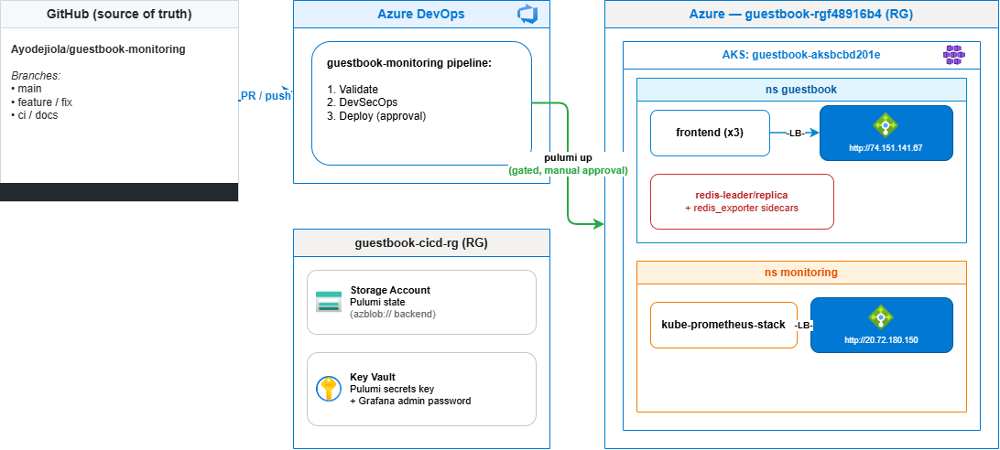

# Guestbook Monitoring Platform

Pulumi-provisioned Kubernetes Guestbook application on Azure Kubernetes Service
(AKS), instrumented with Prometheus and Grafana, with a full Azure DevOps
CI/CD and DevSecOps pipeline. Infrastructure, application, and observability
are defined as a single TypeScript Pulumi program and deployed via
`pulumi up`.

## Table of Contents

- [Overview](#overview)
- [Architecture](#architecture)
- [Technology Stack](#technology-stack)
- [Prerequisites](#prerequisites)
- [Getting Started](#getting-started)
- [Verification](#verification)
- [CI/CD Pipeline](#cicd-pipeline)
- [Security](#security)
- [Operations](#operations)
- [Incident History](#incident-history)
- [Known Limitations](#known-limitations)
- [Contributing](#contributing)
- [Project Structure](#project-structure)

## Overview

This project extends the [Pulumi Kubernetes Guestbook example](https://github.com/pulumi/examples/blob/master/kubernetes-ts-guestbook/README.md)
with a Prometheus + Grafana monitoring stack. It provisions the AKS cluster
itself, deploys the application, installs the monitoring stack, and wires up
a gated Azure DevOps deployment pipeline — all from one codebase.

**Metrics strategy:**
- **Backend (Redis):** each Redis pod runs an `oliver006/redis_exporter`
  sidecar with its own `Service` + `ServiceMonitor`, so Prometheus scrapes
  real Redis metrics (commands/sec, connected clients, memory).
- **Frontend:** the upstream `gb-frontend` image exposes no metrics endpoint
  of its own, so resource usage (CPU/memory) is observed via the
  kubelet/cAdvisor metrics kube-prometheus-stack already scrapes for every
  pod, with no extra configuration required.

## Architecture



**Request flow:** browser → frontend LoadBalancer → PHP frontend
(`gb-frontend:v5`) → `redis-leader` (writes) / `redis-leader` or
`redis-replica` (reads). Each Redis pod's `redis_exporter` sidecar, plus the
cluster-wide kubelet/cAdvisor job, are scraped by Prometheus and rendered in
the auto-provisioned Grafana dashboard.

**Deployment flow:** a change lands on a `feature`/`fix`/`ci`/`docs` branch →
PR into `main` → Azure Pipelines runs `Validate` (build, lint, `pulumi
preview`, Helm template) and `DevSecOps` (secret/dependency/container scans +
SBOM) on every PR and push → merging to `main` makes `Deploy` eligible, but it
stays paused behind an Azure DevOps Environment approval check until a human
approves — `pulumi up` is never triggered by a push alone.

## Technology Stack

| Layer | Technology |
|---|---|
| Infrastructure as Code | Pulumi (TypeScript) |
| Cloud provider | Azure (`azure-native` provider) |
| Compute | Azure Kubernetes Service (AKS) |
| Application | PHP Guestbook frontend, Redis (leader/replica) |
| Monitoring | kube-prometheus-stack (Prometheus, Grafana, Alertmanager, kube-state-metrics, node-exporter) via Helm |
| Secrets | Azure Key Vault (envelope encryption for Pulumi state + app secrets) |
| State backend | Azure Blob Storage |
| CI/CD | Azure DevOps Pipelines |
| Source control | GitHub |
| Security tooling | gitleaks, npm audit, Trivy, CycloneDX SBOM |

## Prerequisites

- [Pulumi CLI](https://www.pulumi.com/docs/install/) (tested with v3.271.0)
- [Node.js](https://nodejs.org/) 18+ (tested with v24.20.0)
- An Azure subscription + [Azure CLI](https://learn.microsoft.com/cli/azure/install-azure-cli), logged in (`az login`)
- `kubectl` and `helm` (not required to deploy — Pulumi's Helm provider
  handles that — but useful for troubleshooting)

## Getting Started

### 1. State backend and secrets provider

Pulumi state lives in **Azure Blob Storage**, not the local filesystem, so
both a human and an Azure Pipelines agent see the same state. Stack secrets
are encrypted with an **Azure Key Vault key** via envelope encryption, not a
shared passphrase.

This is bootstrapped once, outside Pulumi, with plain `az` CLI commands (to
sidestep the chicken-and-egg problem of using Pulumi to create the backend
Pulumi itself needs):

```bash
az group create --name guestbook-cicd-rg --location eastus
az storage account create --name <globally-unique-name> --resource-group guestbook-cicd-rg \
  --location eastus --sku Standard_LRS --kind StorageV2 --min-tls-version TLS1_2 \
  --allow-blob-public-access false
az storage container create --name pulumi-state --account-name <name> --auth-mode login

az keyvault key create --vault-name <vault> --name pulumi-secrets --protection software --kty RSA --size 2048
pulumi stack change-secrets-provider "azurekeyvault://<vault>.vault.azure.net/keys/pulumi-secrets"
```

Anyone running `pulumi` against this stack (including CI) needs:

1. `AZURE_STORAGE_ACCOUNT` + `AZURE_STORAGE_KEY` env vars (or RBAC `Storage
   Blob Data Contributor` on the storage account) to read/write state.
2. Azure AD access to the Key Vault key's `encrypt`/`decrypt`/`wrapKey`/
   `unwrapKey` permissions, granted via a **pinned** access-policy entry in
   `keyvault.ts` (`ownerObjectId` / `ciServicePrincipalObjectId` config
   values — see [Incident History](#incident-history) for why these are
   fixed values, not derived dynamically).
3. Normal Azure RBAC to create/read the deployed resources.

### 2. Deploy

Every `pulumi` command needs `AZURE_STORAGE_ACCOUNT`/`AZURE_STORAGE_KEY` set
in that shell:

```bash
export AZURE_STORAGE_ACCOUNT=<your storage account name>
export AZURE_STORAGE_KEY=$(az storage account keys list --account-name "$AZURE_STORAGE_ACCOUNT" \
  --resource-group guestbook-cicd-rg --query "[0].value" -o tsv)

npm install
pulumi login "azblob://pulumi-state"
pulumi stack select dev                # or: pulumi stack init dev, for a new stack
pulumi config set azure-native:location eastus
pulumi up
```

This single command provisions the resource group and AKS cluster, deploys
the Guestbook app, installs kube-prometheus-stack via Helm, creates
`ServiceMonitor`s for Redis, loads the Grafana dashboard, and outputs the
Guestbook URL, Grafana URL, and credentials. A full deploy from scratch takes
roughly 10–12 minutes.

### 3. Access outputs

```bash
pulumi stack output guestbookUrl
pulumi stack output grafanaUrl
pulumi stack output grafanaAdminUser
pulumi stack output keyVaultName
```

The Grafana admin password is **never** printed in plaintext by this
project — not in `pulumi stack output`, this README, or git history. Retrieve
it from Key Vault or directly from Pulumi state:

```bash
az keyvault secret show --vault-name $(pulumi stack output keyVaultName) \
  --name grafana-admin-password --query value -o tsv

# or
pulumi stack output grafanaAdminPassword --show-secrets
```

To pull a local kubeconfig for `kubectl`/`helm`:

```bash
az aks get-credentials --resource-group $(pulumi stack output resourceGroupName) \
  --name $(pulumi stack output clusterName)
```

## Verification

1. **Prometheus target discovery:**
   ```bash
   kubectl port-forward -n monitoring svc/kube-prometheus-stack-prometheus 9090:9090
   ```
   Open http://localhost:9090/targets — 3 `UP` targets under the
   `redis-leader-servicemonitor-*` and `redis-replica-servicemonitor-*` jobs.

2. **Query real metric data** at http://localhost:9090/graph:
   - `redis_connected_clients{namespace="guestbook"}`
   - `rate(redis_commands_processed_total{namespace="guestbook"}[5m])`
   - `sum(container_cpu_usage_seconds_total{namespace="guestbook"}) by (pod)`

3. **Grafana dashboard:**
   ```bash
   kubectl port-forward -n monitoring svc/kube-prometheus-stack-grafana 3000:80
   ```
   Log into http://localhost:3000, open **Dashboards → Guestbook Overview**
   for live panels covering Redis command rate, connected clients, and
   per-pod CPU/memory. Both Grafana and Prometheus are also reachable
   directly via their public LoadBalancer IPs, without port-forwarding.

**Local checks** (mirrors exactly what the pipeline's `Validate`/`DevSecOps`
stages run):

```bash
npm run build          # tsc --noEmit
npm run lint            # ESLint
npm run format:check    # Prettier
pulumi preview           # infrastructure diff, no apply
```

## CI/CD Pipeline

Organization: `https://dev.azure.com/ayo2corra`, project
`guestbook-monitoring`. Definition: [`azure-pipelines.yml`](azure-pipelines.yml).

| Stage | Purpose | Status |
|---|---|---|
| **Validate** | `npm run build`/`lint`/`format:check`, `pulumi preview`, Helm template render | ✅ Live, passing |
| **DevSecOps** | gitleaks, `npm audit`, Trivy (container scan), CycloneDX SBOM | ✅ Live, passing |
| **Deploy** | `pulumi up`, gated behind the `guestbook-dev` Environment's manual approval check | ✅ Live, verified end-to-end |

Live, verified infrastructure (checked directly against the Azure DevOps API):
- GitHub service connection (`guestbook-monitoring-github`) for repo checkout
- Azure RM service connection (`guestbook-monitoring-azurerm`), backed by a
  service principal scoped to only the two resource groups this project
  uses — not the subscription
- Variable group (`guestbook-monitoring-state`) with the Pulumi backend
  credentials, `AZURE_STORAGE_KEY` stored as a secret variable
- `guestbook-dev` Environment with a real approval check
  (`minRequiredApprovers: 1`) — confirmed to actually pause the pipeline

A full green run (build → lint → `pulumi preview` → security scans → human
approval → `pulumi up` → output verification) has been executed and verified
end-to-end against this live pipeline.

## Security

| Control | Tool | Result |
|---|---|---|
| Secret detection | gitleaks v8.21.2 | Clean — full git history scanned, 0 leaks |
| Dependency scanning | `npm audit --audit-level=high` | Clean — 0 vulnerabilities |
| Container scan — `redis:7.2-alpine` | Trivy v0.76.1 | Clean |
| Container scan — `redis_exporter` | Trivy v0.76.1 | Fixed — 6 HIGH Go-stdlib CVEs in `v1.62.0-alpine`; bumped to `v1.95.0-alpine`, re-scanned clean, deployed |
| Container scan — `gb-frontend:v5` | Trivy v0.76.1 | Accepted exception — unmaintained upstream image, no newer tag published; reported as a non-gating, auditable finding (not suppressed) |
| SBOM | CycloneDX | Generated in CI, published as a pipeline artifact |
| IaC static scan (Checkov/tfsec) | — | Not applicable — these parse Terraform/ARM/CloudFormation; this project is a Pulumi TypeScript program. Equivalent coverage: `tsc`, ESLint, `pulumi preview` |
| SAST | — | Not yet wired in; tracked as a gap, not a false pass |

**Secrets management:** no credential (Grafana password, storage account key,
service principal secret) is ever committed to git or printed in this
document. Generated secrets live in Azure Key Vault; CI secrets live in an
Azure DevOps secret variable or the Key Vault-backed Pulumi secrets provider.

**Repository controls:** branch protection on `main` (no force-push, no
deletion, PR required), GitHub secret scanning + push protection, and
Dependabot security updates are all enabled.

## Operations

### Rollback and recovery

- **Application/infra rollback:** `git revert` the offending commit, then
  either wait for an approved `Deploy` run or run `pulumi up` manually.
  `pulumi preview` always shows the exact change before it happens.
- **Pulumi state recovery:** take a `pulumi stack export` backup before any
  manual (non-Pulumi) change to a managed resource; reconcile drift with
  `pulumi refresh`, never `pulumi state delete`/`import` as a first resort.
- **Stuck/failed Helm release:** `helm list -n <namespace>` to check real
  status; if `failed`, `helm uninstall` it, then `pulumi refresh` before the
  next `pulumi up`.
- **Full teardown:** `pulumi destroy` removes the AKS cluster and its
  resource group. `guestbook-cicd-rg` (Pulumi state storage) is intentionally
  a separate, outside-the-program resource group, so a destroy can never
  delete the state backend it depends on.

```bash
pulumi destroy
```

## Incident History

Real incidents from building and operating this platform — documented with
root cause, fix, and verification evidence, not reconstructed after the fact.

| # | Incident | Root cause | Fix |
|---|---|---|---|
| 1 | Helm release naming collision → node-exporter port conflict | Renaming a Pulumi `Release` triggered a create-before-delete replace; two releases briefly held the same `hostPort: 9100` on a 2-node pool | `helm uninstall` both releases, `pulumi refresh`, clean `pulumi up` |
| 2 | Pulumi state desync after manual `helm uninstall` | Pulumi's state still referenced a Helm release deleted out-of-band, so it tried to *upgrade* a release that no longer existed | `pulumi stack export` backup → `pulumi refresh` to reconcile → verified plan → apply |
| 3 | Guestbook Submit button silently failed | `gb-frontend:v5` has Redis hostnames (`redis-leader`/`redis-follower`) hardcoded; Pulumi's autonamed Services didn't match | Pinned explicit `metadata.name` on the two app-facing Services |
| 4 | `pulumi preview` failed in CI: "Authenticating using the Azure CLI is only supported as a User" | Pulumi's `azure-native` provider rejects an inherited `az login --service-principal` session | `addSpnToEnvironment: true` + native `ARM_*` env vars in the pipeline |
| 5 | Trivy install step failed with no usable error | Pinned Trivy release tag no longer existed upstream | Verified current tag via the releases API, pinned to a confirmed-existing version |
| 6 | DevSecOps stage always reported `succeededWithIssues` | `continueOnError` on an accepted CVE exception masked the stage's true pass/fail signal for every run | Made the accepted-exception scan genuinely non-gating (no exit-code signal) while keeping a hard-fail scan on images this project controls |
| 7 | Deploy job failed: `npm ci` had no `package-lock.json` | Azure Pipelines `deployment:` jobs don't check out the repo by default, unlike regular jobs | Added explicit `checkout: self` as the Deploy job's first step |
| 8 | "Record release outputs" step failed with no Azure credentials | A separate `script:` step doesn't inherit the prior `AzureCLI@2` task's auth session or env vars | Merged the reporting logic into the same authenticated step |
| 9 | CI's `pulumi up` silently revoked the human owner's Key Vault access | The vault's "owner" access policy was derived from *whoever is currently running Pulumi* — which resolved to the CI service principal when CI ran it, collapsing the declared policy to one entry | Pinned both identities (`ownerObjectId`, `ciServicePrincipalObjectId`) as fixed config values instead of deriving one dynamically; access manually restored before the fix via `az keyvault set-policy` |

Each incident above was caught via a real failed run or a direct symptom, root-caused with command-level evidence, fixed, and re-verified against the live system before being marked resolved.

## Known Limitations

- No automated post-deploy smoke test yet (e.g. an automated
  `cmd=set`/`cmd=get` round-trip against the live guestbook) — incident 3 was
  only caught by manual testing.
- No SAST tool wired in yet.
- `gcr.io/google-samples/gb-frontend:v5` carries known HIGH-severity CVEs in
  its Debian base image with no newer upstream tag available — accepted,
  documented exception, not a false "clean" result.
- The service principal backing the Azure RM service connection was created
  directly by the repository owner, not scripted end-to-end: the underlying
  `az ad sp create-for-rbac` and RBAC role assignment require
  Owner/User-Access-Administrator-equivalent rights, reserved for a human to
  grant. Day-to-day `pulumi up` only needs Contributor on the two resource
  groups this project uses.
- Both the Guestbook and Grafana LoadBalancers are public with no IP
  allowlist — acceptable for this review/demo context, not a
  production-appropriate configuration.

## Contributing

**Branching:**

| Prefix | Purpose |
|---|---|
| `main` | Stable, reviewed, protected — PRs required |
| `feature/<name>` | New capabilities |
| `fix/<name>` | Bug fixes |
| `docs/<name>` | Documentation-only changes |
| `ci/<name>` | Pipeline / DevSecOps work |

Commits are small and scoped to one logical change; messages state what was
verified (commands run, actual results), not just what was intended.

## Project Structure

```
Pulumi.yaml          # Pulumi project definition
index.ts             # Entry point: wires cluster -> guestbook -> monitoring, exports outputs
cluster.ts           # AKS cluster + resource group (azure-native)
guestbook.ts         # Redis leader/replica + frontend Deployments/Services, with redis_exporter sidecars
monitoring.ts        # kube-prometheus-stack Helm release + ServiceMonitors + dashboard ConfigMap
keyvault.ts          # Azure Key Vault + pinned access policies
dashboard.json       # Grafana dashboard definition, auto-imported at deploy time
azure-pipelines.yml  # CI/CD + DevSecOps pipeline definition
docs/architecture.drawio  # Editable architecture diagram (official Azure icons)
```
